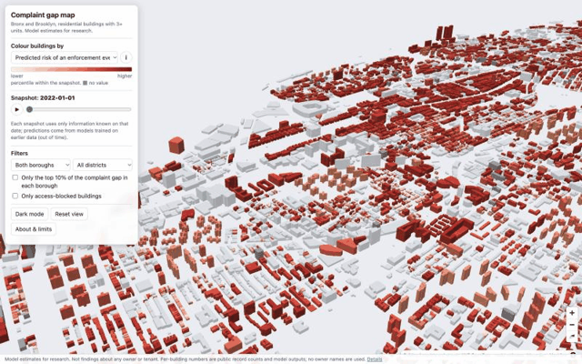
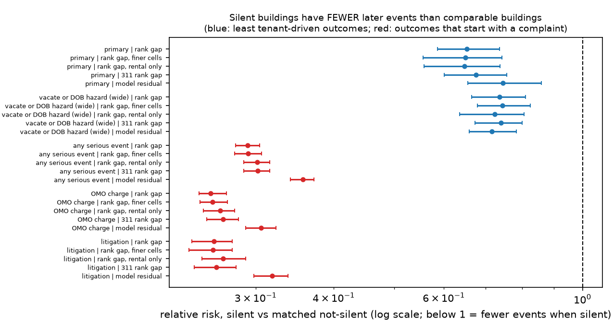
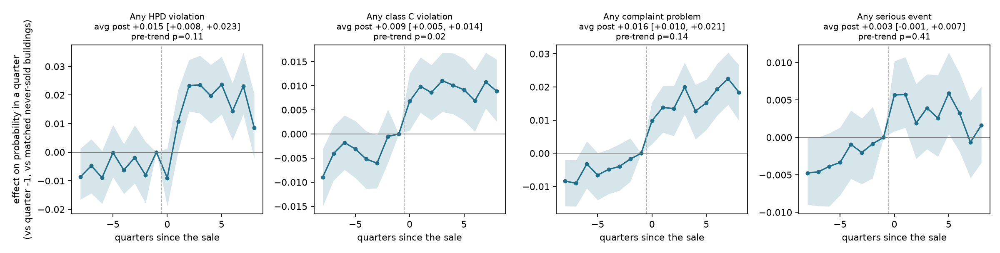
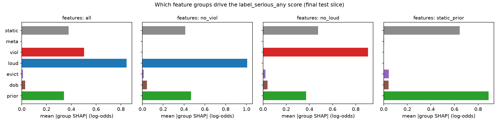
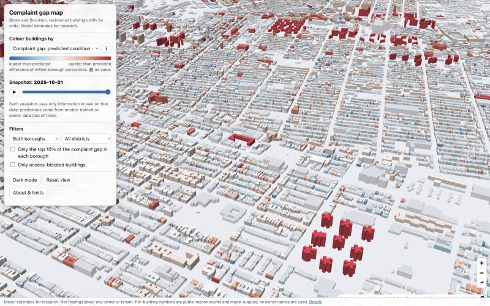
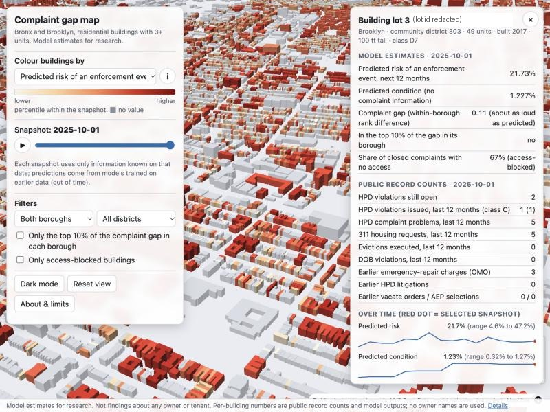
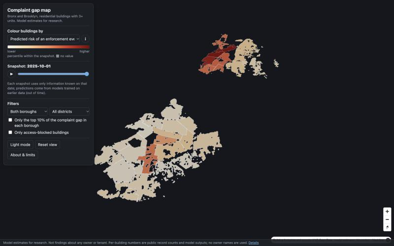
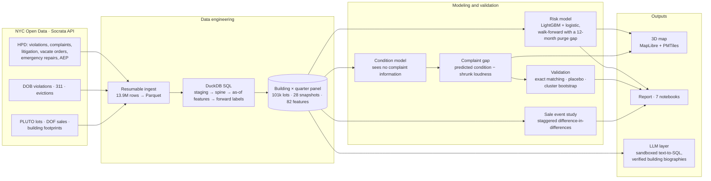

<div align="center">

# 🏙️ Silent Buildings

### The buildings NYC can't hear

**Does a building with no complaints hide danger?**<br>
A leakage-tested data pipeline, out-of-time models, a causal-style validation and a 3D map,<br>
built on 12 NYC Open Data tables covering 101,442 Bronx and Brooklyn residential buildings.

[](https://github.com/moizfakhri/Silent-Buildings/actions/workflows/ci.yml)


[](LICENSE)

[**The answer**](#-the-short-answer) · [**Findings**](#-findings) · [**3D map**](#%EF%B8%8F-the-3d-map) · [**How it works**](#%EF%B8%8F-how-it-works) · [**Quickstart**](#-quickstart) · [**Limits**](#%EF%B8%8F-honest-limitations) · [**Full report**](docs/REPORT.md)



<sub>Real building heights, coloured by an out-of-time model estimate, stepping through quarterly snapshots. Model estimates for research, not findings about any owner or tenant.</sub>

</div>

---

## 💡 The short answer

NYC housing enforcement learns about bad buildings mostly from tenant complaints. If complaints are the city's sensor, a building whose sensor is silent could be hiding trouble. This project tests that idea properly, and reports what it found even though it is not the exciting answer.

> [!IMPORTANT]
> **Mostly, no.** Silence mostly reflects ordinary risk. Buildings that look bad on paper but never complain had **16% fewer** serious events than the model predicted, not more. This is a negative result on the strong hypothesis and a weak positive on a milder one, and it is stated up front on purpose.

Why a negative result is the interesting part: the hypothesis was fixed before the outcomes were examined, the validation was designed so it *could* fail, and it did. Every choice made after seeing data is [disclosed](#-choices-made-after-seeing-data).

## 🔎 Findings

| # | Question | Answer | Evidence |
|:-:|---|---|---|
| 1 | Does a model beat the obvious rule "violations last year"? | **Yes, modestly.** PR-AUC 0.645 vs 0.558, and it wins at 16 of 16 out-of-time snapshots | paired difference +0.087 [0.083, 0.090] · [Phase 3](docs/modeling_phase3.md) |
| 2 | Are silent buildings hiding extra risk? | **No.** They have fewer serious events than predicted and than matched louder buildings | observed/predicted 0.84 [0.76, 0.91]; matched relative risk 0.65 [0.59, 0.74]; placebo 1.00 · [Phase 4](docs/silent_distress_phase4.md) |
| 3 | Is there a real censoring mechanism? | **Yes.** About 16% of closed complaint problems end with "inspector not able to gain access" | but access-blocked buildings show no extra risk: 0.84 [0.68, 0.99] · [Phase 4](docs/silent_distress_phase4.md) |
| 4 | Does any weaker form survive? | **Yes.** Among zero-complaint buildings, predicted condition still predicts next-year complaints | IRR 1.70 per SD [1.65, 1.76] · [Phase 4](docs/silent_distress_phase4.md) |
| 5 | What happens after a building is sold? | **A small rise** in recorded violations and complaints; no detectable change in serious events | +1.5 and +1.6 points; serious events +0.3 [-0.1, +0.7]; 8,500 sales · [Phase 5](docs/sales_phase5.md) |
| 6 | Is RAG useful here? | **No.** Plain SQL keyword search beat retrieval, and text features added nothing | precision@10 0.668 vs 0.526; +0.001 PR-AUC; both pre-declared gates failed · [Phase 7](docs/llm_layer.md) |

<table>
<tr>
<td width="50%" valign="top">

**A fitted model beats the obvious rule at every out-of-time snapshot**


</td>
<td width="50%" valign="top">

**Silent buildings are not riskier than comparable louder ones**



</td>
</tr>
<tr>
<td width="50%" valign="top">

**After a sale, violations and complaints edge up; serious events do not move**



</td>
<td width="50%" valign="top">

**What drives the risk score**



</td>
</tr>
</table>

<details>
<summary><b>The story in five steps</b></summary>

1. **The worry.** Silence has two causes: the building is fine, or nobody can or will report. One cause is measurable: about 16% of closed HPD complaint problems end with "inspector not able to gain access" (13.9% in the Bronx, 17.7% in Brooklyn). No inspection means no violation, which is a censoring mechanism.
2. **A fair baseline first.** A LightGBM model predicts a city enforcement event in the next 12 months better than the rule "violations in the last year" at all 16 out-of-time snapshots. But enforcement is rule driven off violation counts, so the target is partly circular and the score mostly says where the city is already engaged.
3. **The real test.** A second model that *never sees complaint information* gives each building a predicted condition. "Silent" buildings are the top decile whose predicted condition is bad but whose complaint record is empty. If silence hid danger they would have *more* serious events than predicted. They have 16% fewer, and 35% fewer than matched louder buildings.
4. **What survives.** The access-blocked mechanism is real, but access-blocked buildings show no hidden extra risk. A milder form holds: among buildings with no complaint last year, predicted condition still predicts next-year complaints (1.7x per standard deviation). Silent buildings are not louder later than matched controls, which is what regression to the mean predicts.
5. **After a sale.** An event study of 8,500 whole-building sales finds a small rise in recorded violations and complaints, no detectable change in serious events, and no detectable difference for silent buildings. Pre-sale drift means it is not cleanly causal.

</details>

## 🗺️ The 3D map

A static site (MapLibre GL + PMTiles, no build step, no external tiles, works offline) that extrudes every building to its real roof height and colours it by one of five layers.

<table>
<tr>
<td width="50%"></td>
<td width="50%"></td>
</tr>
<tr>
<td align="center"><sub>Predicted risk, Brooklyn</sub></td>
<td align="center"><sub>Complaint gap: warm is quieter than predicted, cool is louder</sub></td>
</tr>
<tr>
<td width="50%"></td>
<td width="50%"></td>
</tr>
<tr>
<td align="center"><sub>Click a building: estimates, public record counts, history</sub></td>
<td align="center"><sub>Zoomed out: community district averages</sub></td>
</tr>
</table>

| Feature | What it does |
|---|---|
| **Five layers** | Predicted risk, predicted condition (no complaint information), complaint gap, no-access share, complaints per unit. The "i" button explains each one and what it does *not* mean |
| **Snapshot slider** | 16 quarterly snapshots, 2022 to 2025. Each uses only information known on that date, scored by a model trained on earlier data |
| **Two zoom levels** | District averages when zoomed out (with their own legend, zero-centred for the gap), individual buildings when zoomed in |
| **Building panel** | Click a building for its estimates, public record counts and sparklines; the selected building is highlighted |
| **Filters** | Borough, community district, top 10% of the complaint gap, access-blocked buildings |
| **Shareable links** | The layer, snapshot and camera are kept in the URL, so any view can be linked |
| **Careful by design** | A disclaimer on first load, neutral layer names, light and dark themes, keyboard and screen-reader labels |

The repository ships a **one-district sample** so the map runs straight after cloning: `make serve`, then open <http://127.0.0.1:8777>. The full two-borough building layer (93 MB of tiles) is built locally with `make map`. Details: [docs/map.md](docs/map.md).

## ⚙️ How it works



**1. Ingest.** A resumable Socrata puller writes 12 tables (13.9M rows) to raw Parquet with keyset paging, retries and cursor files, so an interrupted five-hour pull picks up where it stopped.

**2. Features without leakage.** Every event is assigned to a quarter bucket, and a snapshot only ever sees buckets at or before it. Features use *closure* dates rather than receipt dates wherever an outcome is involved, and a feature window and a label window never share a bucket. A brute-force pandas oracle re-derives every column independently and must match the SQL exactly; mutation checks prove the tests can fail.

**3. Models, strictly forward in time.** Walk-forward folds with a 12-month purge gap between training and evaluation, early stopping on a later purged slice, a final test fold touched once, and bootstrap intervals clustered by building.

**4. The silent-distress test.** A condition model that is forbidden from seeing complaints or complaint-driven violations scores each building. Loudness is an empirical-Bayes complaint rate per unit. The gap between them defines "silent". Outcomes are then compared against the prediction, against coarsened-exact-matched louder buildings, and against a shuffled placebo.

**5. After the sale.** A Callaway and Sant'Anna style event study around whole-building sales, with never-sold buildings reweighted to the treated mix and a pre-trend test.

**6. LLM layer.** Text-to-SQL runs in a locked-down read-only DuckDB sandbox (single SELECT, no file or network access, row and time caps). Building biographies are generated from records and every sentence must cite a record that a verifier can find. RAG was put behind two pre-declared gates and failed both, so it was dropped.

<details>
<summary><b>Tech stack</b></summary>

| Area | Tools |
|---|---|
| Data engineering | Python, DuckDB, Parquet, Polars, pandas, Socrata API |
| Modeling | LightGBM, scikit-learn, statsmodels, SciPy, SHAP |
| Causal and validation | Coarsened exact matching, placebo shuffles, cluster bootstrap, staggered difference-in-differences (implemented here) |
| Visualization | MapLibre GL JS, PMTiles, tippecanoe, Shapely, matplotlib |
| LLM | Sandboxed text-to-SQL, citation-verified generation, BM25 and TF-IDF retrieval baselines |
| Quality | pytest (170 tests on synthetic fixtures), ruff, GitHub Actions, Jupyter |

</details>

<details>
<summary><b>Repository layout</b></summary>

```
src/nycdistress/      core library: build, splits, modeling, evaluation, silent, sales, did, llm/
pipelines/            ingest/ (Socrata), sql/ (staging, spine, features, labels), per-phase train, evaluate and report scripts
app/web/              the static 3D map (MapLibre + PMTiles, vendored), serve.py, the one-district sample
tests/                170 tests on synthetic fixtures, including the leakage oracle
notebooks/            seven executed narrative notebooks and their generator
docs/                 REPORT.md, METHODOLOGY_LOG.md, one document per phase, the map guide
reports/              aggregate tables, JSON and figures for phases 3, 4, 5 and 7
data/                 raw/ interim/ processed/ (gitignored, never published)
```

</details>

## 🚀 Quickstart

Needs Python 3.11+ and [uv](https://docs.astral.sh/uv/). Nothing below needs raw data or an API key.

```bash
git clone https://github.com/moizfakhri/Silent-Buildings.git
cd Silent-Buildings
make setup      # create .venv and install the project with dev, model and map tools
make test       # 170 tests on synthetic fixtures (10 check the real data and skip without it)
make serve      # the 3D map from the bundled sample, at http://127.0.0.1:8777
```

Read the results without running anything: the [full report](docs/REPORT.md), or the executed notebooks in [`notebooks/`](notebooks/) (GitHub renders them).

<details>
<summary><b>Reproduce everything from the raw data</b></summary>

```bash
make ingest     # full resumable pull from data.cityofnewyork.us into data/raw/ (hours)
make audit      # write docs/data_audit.md from data/raw/
make features   # spine, as-of features, forward labels -> data/processed/ (about 10 s)
make model      # logistic + LightGBM, all folds and ablations (about 40 min, resumable)
make evaluate   # metrics with bootstrap CIs, calibration, SHAP -> reports/phase3/
make silent     # condition models, loudness, complaint gaps, validation (about 17 min)
make report4    # Phase 4 figures and tables
make marts      # DuckDB marts for the LLM layer; then make llm-eval and make llm-experiments (offline)
make sales      # the sale study (needs make ingest NAMES="dof_sales" and make marts; about 1 min)
make map        # the full 3D map data (needs footprints and tippecanoe)
make notebooks  # re-execute the seven notebooks from the committed outputs
make llm-live   # live model evaluation; needs ANTHROPIC_API_KEY in .env and costs credits
```

- `make ingest` is resumable. Pull a subset with `make ingest NAMES="pluto hpd_aep"` or smoke test with `make ingest ARGS="--limit-pages 1"`.
- A free Socrata app token in `.env` (copy `.env.example`) raises rate limits. `.env` is gitignored and its values are never printed.
- `tippecanoe` is only needed for the map tiles.

</details>

## 🧪 Data-quality findings

- **Keys are clean and the join loss is explained.** 99.6% of violation and complaint lot ids join to PLUTO. The three citywide tables match 60 to 78% because they include other boroughs.
- **Impossible dates exist** (a violation status date in year 9202, vacate dates in 2040, a litigation in 2030) and are filtered by stated rules.
- **15.7% of complaint problem rows are closed for no access.** It is a property of the measurement, not of the buildings.
- **The ACRIS open-data deed extract covers only about 8% of recent deeds**, so it could not support the sale study. Department of Finance sales were used after a pre-declared coverage rule failed.
- **HPD violation text is mostly unique; DOB text is heavily templated.** Text features gave a negligible gain.

More in [docs/data_audit.md](docs/data_audit.md) and [docs/labels_and_features.md](docs/labels_and_features.md).

## ⚠️ Honest limitations

- **The model predicts city actions, not physical condition.** A high score mostly means the city is already engaged with the building.
- **The outcomes that validate "silent" are partly downstream of complaints**, so a silent building would show fewer of them even with the same physical problems. The least tenant-driven outcome (relative risk 0.65) is not fully independent either.
- **The silent flag depends on a model** with ROC-AUC 0.80 to 0.85 against a 0.55% base rate. 77% of building snapshots have no complaint in a year, so silence is the norm.
- **The sale study is observational.** Sale timing is not random, complaints were already drifting up before sales, LLC-interest transfers are invisible, and the silent subgroup has only 453 sold buildings.
- **No demographic data were used.** "Silent" must not be read as "neglected" or "disadvantaged".
- **Fairness.** Borough and building class are strong features, and the silent share ranges from 2.5% to 16.8% across community districts. Do not use these scores to prioritise or deprioritise inspections without a separate fairness review.
- **Not done:** a live LLM evaluation (the harness is tested offline against stubs), ACS demographics, an owner-portfolio analysis, a hierarchical Bayesian model.

## 📋 Choices made after seeing data

- The Phase 4 primary outcome switched from the wide to the core DOB-hazard definition after seeing event-rate instability and calibration, before any gap result existed.
- Finer matching, a covariate-adjusted regression, and rental-only and co-op checks were added after the balance table. All are reported next to the original.
- Phase 3 added a `quiet` slice and a LightGBM-vs-logistic comparison after the first results. No fitted model changed.
- Phase 5 abandoned ACRIS after a pre-declared coverage rule failed and restricted sales to whole buildings after the first count showed condo and parking rows.

Everything else (the silent definition, the 10% cutoff, the strata, the calibration rule, the sale-study specification, the two RAG gate rules) was fixed before the corresponding outcomes were examined. Nothing was tuned on the final test slice. Full list with timing: [docs/METHODOLOGY_LOG.md](docs/METHODOLOGY_LOG.md).

## 📚 Documentation

| Document | What is in it |
|---|---|
| [docs/REPORT.md](docs/REPORT.md) | The paper-style write-up of the whole project |
| [docs/METHODOLOGY_LOG.md](docs/METHODOLOGY_LOG.md) | Every decision, and whether it was made before or after seeing data |
| [docs/labels_and_features.md](docs/labels_and_features.md) | Feature and label definitions, and the leakage design |
| [docs/modeling_phase3.md](docs/modeling_phase3.md) | Baselines, models, ablations, calibration, SHAP |
| [docs/silent_distress_phase4.md](docs/silent_distress_phase4.md) | The silent-distress test and its validation |
| [docs/sales_phase5.md](docs/sales_phase5.md) | The after-the-sale event study |
| [docs/llm_layer.md](docs/llm_layer.md) | Text-to-SQL sandbox, biographies, and the RAG gates |
| [docs/map.md](docs/map.md) | How the 3D map is built and how to read it |
| [docs/DATASETS.md](docs/DATASETS.md) | The 12 source tables, their ids and join keys |

## 🔒 Data, privacy and license

- **No raw data is redistributed here.** The pipeline pulls it from NYC Open Data. Only aggregate tables, figures and a one-district map sample are in the repository.
- **No owner, buyer, tenant or contact names appear anywhere.** The map sample holds public record counts and model estimates for buildings in one community district; those estimates are research outputs and are wrong for many individual buildings.
- **License:** [MIT](LICENSE). Vendored MapLibre GL JS and PMTiles are BSD-3-Clause, see [THIRD_PARTY_NOTICES.md](THIRD_PARTY_NOTICES.md).
- **Data source:** NYC Open Data (HPD, DOB, DOF, DCP, 311), used under the City's open data terms. This project is independent and is not affiliated with or endorsed by the City of New York.
