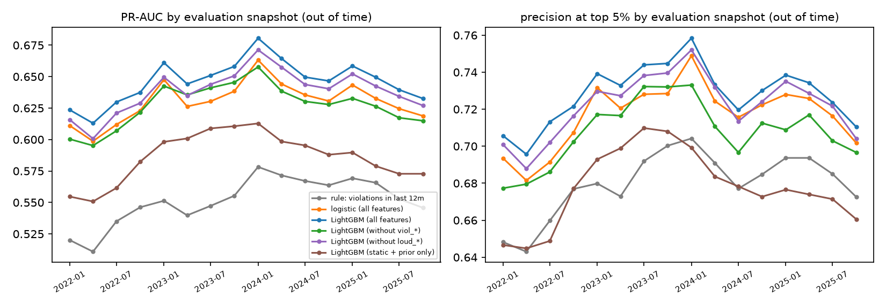
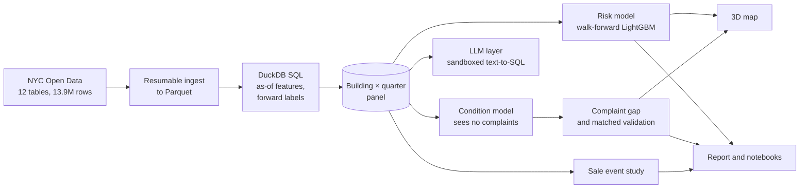

<div align="center">

# Silent Buildings

**Does a building with no complaints hide danger?**<br>
A leakage-tested pipeline, out-of-time models and a 3D map on 12 NYC Open Data tables,<br>
covering 101,442 Bronx and Brooklyn residential buildings.

[](https://github.com/moizfakhri/Silent-Buildings/actions/workflows/ci.yml)


[](LICENSE)

[Findings](#findings) · [3D map](#the-3d-map) · [How it works](#how-it-works) · [Quickstart](#quickstart) · [Limitations](#limitations) · [Full report](docs/REPORT.md)


</div>

## The short answer

NYC housing enforcement learns about bad buildings mostly from tenant complaints. If complaints are the city's sensor, a building whose sensor is silent could be hiding trouble. This project tests that.

> [!IMPORTANT]
> **Mostly, no.** Buildings that look bad on paper but never complain had **16% fewer** serious events than predicted, not more. Silence mostly reflects ordinary risk.

The hypothesis was fixed before the outcomes were examined, and the validation was designed so that it could fail. It did, and that is reported as the result.

## Findings

| Question | Answer | Evidence |
|---|---|---|
| Does a model beat "violations last year"? | **Yes, modestly**, at 16 of 16 out-of-time snapshots | PR-AUC 0.645 vs 0.558 · [Phase 3](docs/modeling_phase3.md) |
| Are silent buildings hiding extra risk? | **No** | observed/predicted 0.84 [0.76, 0.91]; matched relative risk 0.65 [0.59, 0.74] · [Phase 4](docs/silent_distress_phase4.md) |
| Is there a real censoring mechanism? | **Yes**: 16% of closed complaints end with no inspector access, but those buildings show no extra risk | 0.84 [0.68, 0.99] · [Phase 4](docs/silent_distress_phase4.md) |
| Does a weaker form survive? | **Yes**: among zero-complaint buildings, predicted condition predicts later complaints | IRR 1.70 per SD [1.65, 1.76] · [Phase 4](docs/silent_distress_phase4.md) |
| What happens after a sale? | **A small rise** in violations and complaints; serious events do not move | +1.5 and +1.6 points; 8,500 sales · [Phase 5](docs/sales_phase5.md) |
| Is RAG useful here? | **No**: SQL keyword search beat retrieval | precision@10 0.668 vs 0.526 · [Phase 7](docs/llm_layer.md) |

<table>
<tr>
<td width="50%"></td>
<td width="50%"></td>
</tr>
<tr>
<td align="center"><sub>The model beats the obvious rule at every snapshot</sub></td>
<td align="center"><sub>Silent buildings are not riskier than matched louder ones</sub></td>
</tr>
</table>

## The 3D map

A static site (MapLibre GL and PMTiles, no build step, works offline) that extrudes every building to its real height and colours it by one of five layers.

<table>
<tr>
<td width="50%"></td>
<td width="50%"></td>
</tr>
</table>

- **Five layers** with a plain-language explanation of each, and a slider across 16 quarterly snapshots.
- **District averages** when zoomed out, individual buildings when zoomed in.
- **Click a building** for its estimates, public record counts and history.
- **Filters and shareable links**: the layer, snapshot and camera live in the URL.

A one-district sample is included, so `make serve` works straight after cloning. The full two-borough layer is built with `make map`. More in [docs/map.md](docs/map.md).

## How it works



- **No leakage.** Features only see events dated at or before the snapshot, and feature and label windows never overlap. An independent pandas oracle must match the SQL on every column.
- **Strictly forward in time.** Walk-forward folds with a 12-month purge gap, a test fold touched once, and bootstrap intervals clustered by building.
- **The silent test.** A model barred from complaint data predicts condition; the gap to observed complaints defines "silent". Outcomes are compared against the prediction, matched louder buildings and a shuffled placebo.
- **After a sale.** A staggered difference-in-differences event study with a pre-trend test.
- **LLM layer.** Text-to-SQL in a read-only sandbox, and building summaries where every sentence must cite a record. RAG failed two pre-declared gates and was dropped.

**Stack:** Python, DuckDB, Parquet, LightGBM, scikit-learn, statsmodels, SHAP, MapLibre GL, PMTiles, tippecanoe, pytest, GitHub Actions.

## Quickstart

Needs Python 3.11+ and [uv](https://docs.astral.sh/uv/). No raw data or API key required.

```bash
git clone https://github.com/moizfakhri/Silent-Buildings.git
cd Silent-Buildings
make setup      # create .venv and install
make test       # 170 tests on synthetic fixtures (10 need the real data and skip without it)
make serve      # the 3D map at http://127.0.0.1:8777
```

To read the results without running anything, see the [full report](docs/REPORT.md) or the executed [notebooks](notebooks/).

<details>
<summary>Reproduce everything from the raw data</summary>

```bash
make ingest     # resumable pull from NYC Open Data (hours)
make features   # spine, features, labels (about 10 s)
make model      # all folds and ablations (about 40 min)
make evaluate   # metrics, calibration, SHAP
make silent     # condition models, gaps, validation (about 17 min)
make marts      # DuckDB marts for the LLM layer and the sale study
make sales      # the sale study (needs make ingest NAMES="dof_sales")
make map        # full 3D map data (needs tippecanoe)
```

A free Socrata app token in `.env` (copy `.env.example`) raises rate limits. See the [Makefile](Makefile) for every target.

</details>

<details>
<summary>Repository layout</summary>

```
src/nycdistress/   core library
pipelines/         ingest, SQL, per-phase train, evaluate and report scripts
app/web/           the 3D map and its one-district sample
tests/             170 tests, including the leakage oracle
notebooks/         seven executed notebooks
docs/              report, methodology log, one document per phase
reports/           aggregate tables and figures
```

</details>

## Limitations

- **The model predicts city actions, not physical condition.** A high score mostly means the city is already engaged.
- **The validating outcomes are partly downstream of complaints**, so silent buildings would show fewer of them regardless.
- **The sale study is observational** and shows some pre-sale drift.
- **No demographic data were used.** "Silent" does not mean "neglected".
- **Not for operational use.** Scores differ by borough and district; do not use them to prioritise inspections without a fairness review.

Choices made after seeing data are listed in [docs/METHODOLOGY_LOG.md](docs/METHODOLOGY_LOG.md).

## Data, privacy and license

No raw data is redistributed, and no owner, tenant or contact names appear anywhere. The map shows model estimates for research, which are wrong for many individual buildings.

[MIT](LICENSE) licensed; vendored libraries are listed in [THIRD_PARTY_NOTICES.md](THIRD_PARTY_NOTICES.md). Data from NYC Open Data (HPD, DOB, DOF, DCP, 311). This project is independent and not affiliated with the City of New York.
