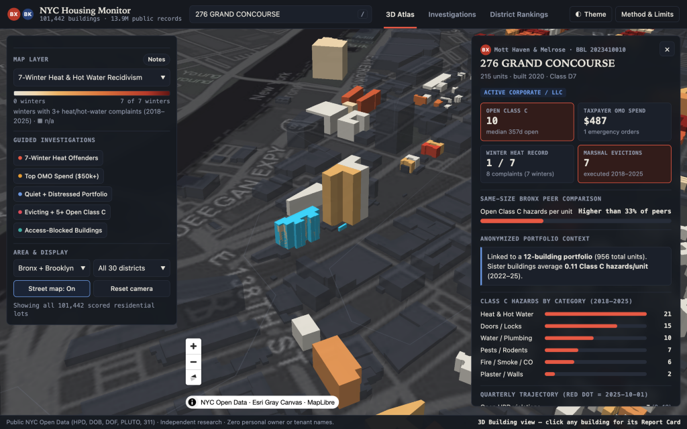
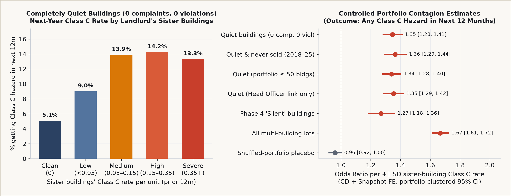
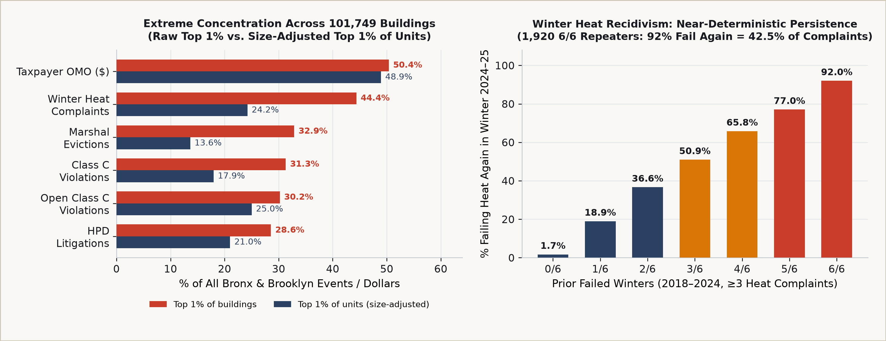
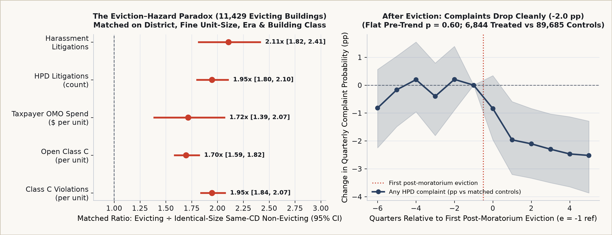
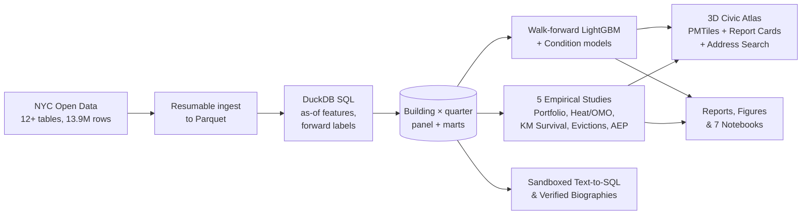

<div align="center">

# NYC Housing Monitor

**What NYC’s complaint-driven housing enforcement misses — landlord portfolio networks, chronic repeaters, and enforcement bottlenecks.**<br>
Leakage-tested DuckDB + LightGBM pipelines, five empirical investigations, and an interactive 3D atlas across **101,442 Bronx & Brooklyn residential buildings** and **13.9 million NYC Open Data records**.

[](https://github.com/moizfakhri/Silent-Buildings/actions/workflows/ci.yml)


[](LICENSE)

[Key Findings](#key-findings) · [3D Atlas & Web App](#the-3d-atlas) · [How It Works](#how-it-works) · [Quickstart](#quickstart) · [Full Investigations](docs/STUDIES.md) · [Technical Report](docs/REPORT.md)

<p align="center">
  
</p>

</div>

## The Thesis

New York City enforces residential housing conditions **one complaint and one building at a time**. We originally tested whether a building’s own lack of complaints hides danger—and found that **on its own, silence reflects ordinary risk** (silent buildings had 16% fewer vacate/DOB-hazard events than predicted).

Looking deeper across **13.9 million public records** (HPD violations, complaints, emergency repair awards, litigations, AEP, vacate orders, registration contacts, DOB violations, marshal evictions, DOF sales, and PLUTO), the real blind spots sit **above** the individual complaint:

> [!IMPORTANT]
> 1. **Portfolio contagion rescues prediction for quiet buildings:** Among buildings with **0 complaints and 0 violations**, sister-building Class C distress nearly triples next-year Class C risk (`5.1% → 14.2%`, controlled **OR 1.35 [1.28, 1.41]**, `p = 3.5e-35`; shuffled placebo **OR 0.96**).
> 2. **Extreme concentration:** **1% of buildings** absorb **50.4%** of taxpayer emergency repair (OMO) dollars (\$196.1M in spine / \$700M BX+BK all-time), and **1.7% (1,766 buildings)** generate **48.2%** of all winter heat emergencies across 7 consecutive winters.
> 3. **Systemic enforcement breakdowns:** "24-hour" Class C hazards have a Kaplan-Meier median closure time of **110 days** (**590d** for Mold, **265d** for Pests, **256d** for Lead Paint), winter surge cuts violation issuance in half (**68% → 33%**), **80.9%** of post-moratorium evictions occur inside Class C hazardous buildings, and **70.2%** of buildings discharged from HPD’s flagship AEP program relapse within 2 years.

---

## Key Findings

| Investigation | Finding | Verified Evidence (95% CI) | Deep Dive |
|---|---|---|---|
| **1. Landlord Portfolio Contagion** | Quiet buildings owned alongside distressed sister buildings face ~3× higher next-year Class C risk. | Quiet buildings (`n=38,110`): **OR 1.35 [1.28, 1.41]** (`p=3.5e-35`); never-sold lots **OR 1.36**; shuffled placebo **OR 0.96 [0.92, 1.00]**. Out-of-time LightGBM lift on clean-record buildings: **+29% relative PR-AUC** (`+0.0089 [+0.0016, +0.0179]`). | [Study 1](docs/STUDIES.md#study-1--landlord-portfolio-networks--cross-building-contagion) |
| **2. The 1% & 7-Winter Heat Recidivism** | Distress is concentrated in chronic repeat offenders, even after controlling for building size. | Top 1% of buildings = **50.4%** of OMO spend (**unit Gini 0.917**). **1,766** 7-winter heat repeaters = **48.2%** of winter emergencies (**79.6%** never in AEP). `6/6` prior winters → **92.0%** fail again in 2024–25. | [Study 2](docs/STUDIES.md#study-2--extreme-concentration-omo-spending--7-winter-heat-recidivism) |
| **3. "Zombie Class C" & Winter Bottleneck** | Immediately hazardous violations sit open for months to years; winter congestion halves enforcement yield. | Kaplan-Meier median (1.06M Class C): **110d** (**33.3%** open at 1yr, **20.6%** at 3yr). **Mold 590d**, **Pests 265d**, **Lead 256d**. Violation yield drops **67.7% (Aug) → 33.2% (Dec)**. | [Study 3](docs/STUDIES.md#study-3--the-zombie-class-c-enforcement-breakdown--winter-bottleneck) |
| **4. The Eviction–Hazard Paradox** | Evictions concentrate in hazardous buildings even matched to identical-size same-district peers. | **80.9%** of 31,202 post-moratorium evictions in Class C hazardous buildings (**60.9%** with 5+). Matched CEM: **1.95× [1.84, 2.07]** Class C/unit, **2.11× [1.82, 2.41]** harassment suits; post-eviction complaints drop **-2.0 pp** (`p=0.60` pre-trend). | [Study 4](docs/STUDIES.md#study-4--the-evictionhazard-paradox) |
| **5. AEP Relapse, Sales & Vacate Subtypes** | AEP cuts OMO while active but 70% relapse after discharge; sales do not cure distressed buildings. | Discharged AEP (`n=1,022`): **70.2%** get 5+ new Class C in 2y, **62.0%** need new OMO, **26.9%** re-enter AEP. Distressed sales (`n=674`): Class C unchanged (`+1.8 pp [-2.1, +5.3]`). **58.4%** of vacates are Fire Damage. | [Study 5](docs/STUDIES.md#study-5--aep-relapse-heterogeneous-sales--vacate-subtypes) |
| **Baseline & Null Findings (Honest Audit)** | Standalone silence is not hidden danger; walk-forward LightGBM beats violation rules; RAG failed its gates. | Out-of-time PR-AUC **0.645 vs 0.558** across 16/16 snapshots ([Phase 3](docs/modeling_phase3.md)). Standalone silent O/E **0.84 [0.76, 0.91]** ([Phase 4](docs/silent_distress_phase4.md)). SQL keywords beat BM25 RAG **0.668 vs 0.526** ([Phase 7](docs/llm_layer.md)). | [Report](docs/REPORT.md) |

### Visual Evidence

<p align="center">
  <br>
  <sub><b>Study 1 — Portfolio Contagion:</b> Sister-building Class C distress nearly triples next-year Class C risk in completely quiet buildings (0 complaints, 0 violations); shuffled-portfolio placebo is null (OR 0.96).</sub>
</p>

<p align="center">
  <br>
  <sub><b>Study 2 — Chronic Concentration:</b> Top 1% of buildings absorb 50.4% of taxpayer OMO dollars (unit-weighted Gini 0.917); buildings failing 6/6 prior winters fail again 92.0% of the time.</sub>
</p>

<details>
<summary><b>View full-width figures for Studies 3, 4 &amp; 5 (Zombie Class C Survival, Eviction–Hazard Paradox, AEP Relapse &amp; Sales)</b></summary>

<p align="center">
  <br>
  <sub><b>Study 3 — Enforcement Breakdown:</b> Kaplan-Meier survival across 1.06M "24-hour" Class C violations (Mold 590d, Pests 265d, Lead 256d) and the winter violation-yield collapse (68% → 33%).</sub>
</p>

<p align="center">
  <br>
  <sub><b>Study 4 — Eviction–Hazard Paradox:</b> Evicting buildings carry 1.95× more Class C hazards/unit and 2.11× more harassment suits than identical-size same-district peers; complaints drop -2.0 pp after eviction.</sub>
</p>

<p align="center">
  <br>
  <sub><b>Study 5 — Interventions &amp; Sales:</b> AEP cuts OMO repairs ~20 pp while active yet 70.2% of discharged buildings relapse within 2 years; whole-building sales do not cure distressed buildings.</sub>
</p>

</details>

---

## The 3D Atlas

A static, zero-build-step civic cartography web app (`app/web/`) built with MapLibre GL and PMTiles. It extrudes **120,705 residential footprints** to their true roof height and integrates three views:

<p align="center">
  <br>
  <sub><b>Investigations view:</b> All 5 empirical studies with interactive charts, caveats, and one-click "Inspect on 3D Atlas" jumps.</sub>
</p>

<p align="center">
  <br>
  <sub><b>District Rankings:</b> All 30 named Bronx &amp; Brooklyn neighborhoods—sortable across every metric, click any row to fly there in 3D.</sub>
</p>

- **8 map layers** spanning the 5 investigations (*7-Winter Heat Recidivism*, *Taxpayer OMO Spend*, *Open "Zombie" Class C*, *Portfolio Contagion*, *Marshal Evictions*) and 16 out-of-time quarterly model snapshots (*Enforcement Risk*, *Complaint Gap*, *No-Access Rate*).
- **Instant address, neighborhood, & BBL search** (`/` shortcut) across 101,442 lots via 283 static prefix shards.
- **Building Report Cards** with real street address, neighborhood, HPD registration status, open Class C median age, OMO dollars, peer-percentile bar, anonymized portfolio context, hazard category breakdown, and 16-quarter sparklines.
- **5 one-click Guided Investigation filters**, light/dark archival civic theme, and shareable URL hashes.

A one-district sample is committed so `make serve` runs straight after cloning. See [docs/map.md](docs/map.md).

---

## How It Works



- **Strict leakage guards:** Features see only events dated at or before each snapshot; an independent pandas oracle verifies SQL parity on every column, with mutation tests confirming broken SQL fails CI.
- **Strictly forward in time:** Walk-forward folds with a 12-month purge gap, a single-touch test fold, and building-/portfolio-clustered bootstrap CIs.
- **Causal & survival rigor:** Callaway & Sant’Anna staggered DiD with pre-trend tests, Coarsened Exact Matching (CEM), right-censoring-adjusted Kaplan-Meier survival curves, and shuffled-portfolio placebos.

**Stack:** Python 3.12, DuckDB, Parquet, LightGBM, scikit-learn, statsmodels, SHAP, MapLibre GL, PMTiles, tippecanoe, pytest, Ruff, GitHub Actions.

---

## Quickstart

Requires Python 3.11+ and [uv](https://docs.astral.sh/uv/). No raw data or API keys are needed to run tests or launch the sample 3D Atlas.

```bash
git clone https://github.com/moizfakhri/Silent-Buildings.git
cd Silent-Buildings
make setup      # create .venv and install dependencies
make test       # 170 tests on synthetic fixtures (data-dependent tests skip cleanly)
make serve      # launch NYC Housing Monitor at http://127.0.0.1:8777
```

<details>
<summary>Reproduce everything end-to-end from NYC Open Data</summary>

```bash
make ingest     # resumable pull from NYC Open Data (add SOCRATA_APP_TOKEN in .env)
make features   # spine, 82 as-of features, forward labels (~10s)
make model      # walk-forward LightGBM & logistic folds (~40 min)
make evaluate   # metrics, calibration, SHAP
make silent     # Phase 4 condition models, complaint gaps & validation (~17 min)
make marts      # DuckDB analytical marts (~5s)
make sales      # Phase 5 sale event study (~1 min)
make studies    # Studies 1–5 (portfolio contagion, heat/OMO, KM survival, evictions, AEP) + figures
make map        # rebuild 101 MB buildings.pmtiles, 1,205 fact shards & 283 search shards (~2 min; needs tippecanoe)
```

</details>

<details>
<summary>Repository layout</summary>

```text
src/nycdistress/     core library (splits, modeling, metrics, DiD, silent validation, LLM sandbox)
pipelines/           ingest, DuckDB SQL, phase scripts, and pipelines/studies/ (Studies 1–5)
app/web/             static 3D Civic Atlas, Building Report Cards, Investigations & Rankings
tests/               170 automated tests including the pandas leakage oracle and schema/PII checks
notebooks/           seven executed walkthrough notebooks
docs/                STUDIES.md, REPORT.md, METHODOLOGY_LOG.md, map.md, and per-phase docs
reports/             reproducible CSV/JSON tables and publication figures
```

</details>

---

## Privacy, Ethics & License

- **Zero personal names:** No owner, landlord, managing agent, respondent, or tenant names appear anywhere in code, outputs, tiles, or shards. Portfolio links use anonymized hashes of normalized HPD registration business addresses.
- **Not a legal verdict or operational inspection tool:** Model probabilities and aggregate patterns are for independent research and are wrong for many individual buildings. No demographic data were used.
- **License:** [MIT](LICENSE); vendored libraries are listed in [THIRD_PARTY_NOTICES.md](THIRD_PARTY_NOTICES.md). Data sourced from NYC Open Data (HPD, DOB, DOF, DCP, 311). Independent project, not affiliated with the City of New York.
