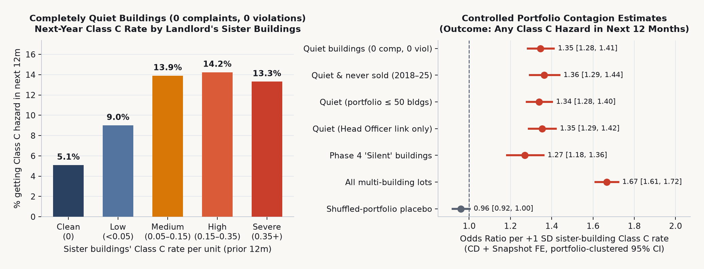
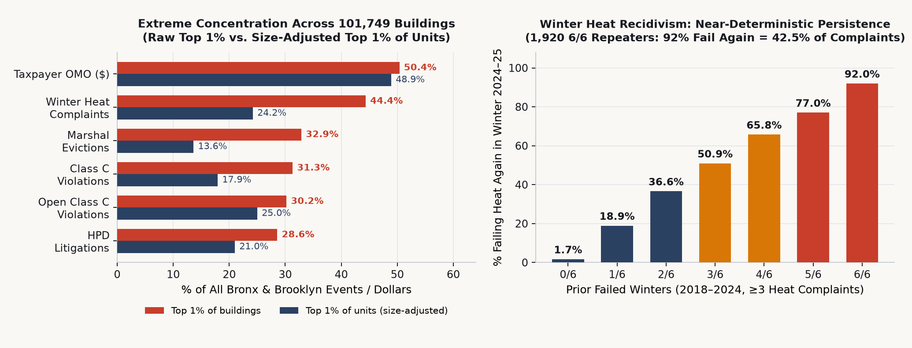
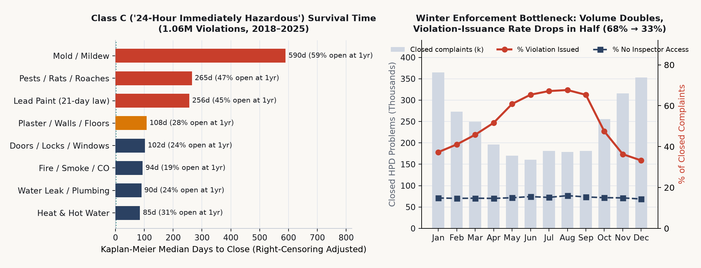
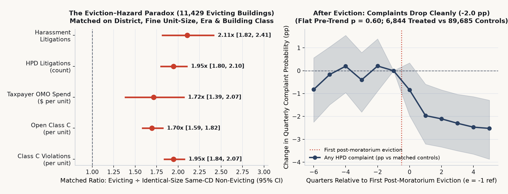
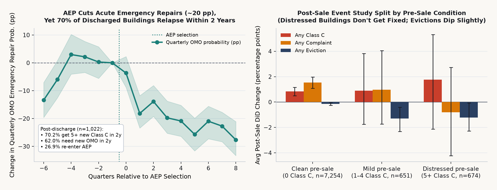

# Five Deep Investigations into NYC Housing Distress & Enforcement

Empirical dossier across **101,442 Bronx and Brooklyn residential buildings** (3+ units, 2018–2025) and **13.9 million NYC Open Data records**. Every table, confidence interval, placebo test, and figure is reproducible via `pipelines/studies/study{1..5}_*.py` and `pipelines/studies/make_figures.py`. Zero personal owner, landlord, respondent, or tenant names are stored or emitted anywhere.

---

## Executive Scorecard — Which Findings Are Strongest?

| Study | Headline Finding | Key Estimate & 95% CI | Robustness / Caveat |
|---|---|---|---|
| **1. Landlord Portfolio Contagion** *(Strongest new main finding)* | A quiet building’s silence isn’t safe when its landlord’s *other* buildings are failing. | Quiet buildings (0 comp, 0 viol, n=38,110): **OR 1.35 [1.28, 1.41]** (`p = 3.5e-35`) for next-year Class C; **OR 1.31 [1.23, 1.41]** for serious events. On clean-record buildings, LOO portfolio features lift out-of-time PR-AUC **+29% relative** (`0.0309 → 0.0399`, `+0.0089 [+0.0016, +0.0179]`) & ROC-AUC **`+0.020 [+0.002, +0.039]`**. | Shuffled-portfolio placebo = clean null (**OR 0.96 [0.92, 1.00]**). Holds on never-sold buildings (**OR 1.36**), Head-Officer-only links (**OR 1.35**), and ≤50-bldg portfolios (**OR 1.34**). Caveat: HPD registrations are current-state. |
| **2. Extreme Concentration & 7-Winter Heat Recidivism** *(Strongest civic headline)* | 1% of buildings absorb **50.4%** of taxpayer emergency repairs; 1.7% drive **48.2%** of winter heat emergencies. | OMO unit-weighted Gini = **0.917** (top 1% of units = **48.9%** of \$196.1M spine / \$700M BX+BK all-time). **1,766 buildings (1.7%)** failed heat in all 7 winters (**79.6%** never in AEP). Buildings failing 6/6 prior winters fail again **92.0%** of the time. | Unit-weighted Gini confirms concentration is **not** a big-building artifact. Top 0.5% of portfolios (191 portfolios) drive **50.0%** of OMO dollars (**2.55×** their unit share). |
| **3. "Zombie Class C" Enforcement Breakdown** *(Strongest systemic critique)* | "24-hour" immediately hazardous violations sit open for months to years; winter volume cuts enforcement yield in half. | Right-censoring-adjusted Kaplan-Meier median closure across 1.06M Class C violations: **110 days** (**33.3%** open at 1yr, **20.6%** at 3yr). **Mold: 590d**, **Pests: 265d**, **Lead Paint (21-day law): 256d**. Violation-issuance rate collapses **67.7% (Aug) → 33.2% (Dec)** as winter complaints double. | False certifications (`n=512` matched) show *slightly lower* subsequent Class C (**0.84×**) — catching a false cert appears to trigger enforcement pressure rather than impunity. |
| **4. The Eviction–Hazard Paradox** *(High-impact policy finding)* | **80.9%** of post-moratorium evictions (2022–25) occurred inside buildings with open Class C hazards. | Matched on CD × fine unit-size × era × class (`11,429` vs `80,513` buildings): evicting buildings have **1.95× [1.84, 2.07]** Class C/unit, **1.72× [1.39, 2.07]** OMO \$/unit, **2.11× [1.82, 2.41]** harassment litigations. Controlled Poisson IRR = **2.47 [2.30, 2.64]**. Post-eviction complaints drop **-2.0 pp [-3.0, -1.0]** (pre-trend `p = 0.60`). | Building-level data cannot isolate individual tenant motives, though pre-eviction Class C ramp + post-eviction complaint drop aligns with habitability disputes or displacement of vocal tenants. |
| **5. AEP Relapse, Heterogeneous Sales & Vacate Subtypes** *(Sharp nuance & Phase 4/5 upgrade)* | AEP cuts OMO repairs ~20pp while active, yet **70.2%** of discharged buildings relapse in 2 years; sales don't fix distressed buildings. | Discharged AEP (`n=1,022`, median 217d in program): **70.2%** get 5+ new Class C within 2y, **62.0%** need new OMO, **26.9%** re-enter AEP. Distressed sales (`n=674`): Class C unchanged (`+1.8 pp [-2.1, +5.3]`), evictions dip slightly (`-1.2 pp [-2.3, -0.1]`). **58.4%** of vacates are Fire Damage (silent RR `0.41`), vs DOB physical hazards (`0.86 [0.72, 1.05]`). | AEP DiD has strong pre-trend spike (selection at peak), so the post-discharge relapse rate is the cleaner finding. |

---

## Study 1 — Landlord Portfolio Networks & Cross-Building Contagion

- **Linkage:** Normalized HPD Registration Contact business addresses (excluding PO boxes and 200+ building generic maildrops) link **65,621 of 101,749 spine buildings** into **38,252 anonymized portfolios** (SHA-256 hash IDs; zero personal names stored).
- **Registration & size gradients (`reports/studies/study1_registration_groups.csv`, `study1_portfolio_size_gradient.csv`):**
  - Moving from single-building owners to 20–49 building portfolios, Class C violations/unit more than double (`0.454 → 1.072`) and evictions/1k units more than double (`16.2 → 37.6`).
  - **Expired HPD Registrations** (`14,967` buildings) incur **\$212.6/unit** in taxpayer OMO spend (over 2× active corporate and 2.7× active individual owners) and carry the highest open Class C rate (`0.304`/unit).
- **Controlled contagion (`reports/studies/study1_contagion_regressions.csv`):**
  - Among **38,110 completely quiet building-years** (0 complaints & 0 violations in prior 12 months, 4,969 portfolios), controlling for Community District FE, Snapshot FE, log units, year built, and portfolio size (portfolio-clustered SEs):
    - Next-12m Class C hazard: **OR 1.346 [1.284, 1.410]** (`z = 12.38`, `p = 3.5e-35`).
    - Next-12m serious enforcement event: **OR 1.314 [1.229, 1.405]** (`z = 7.98`, `p = 1.5e-15`).
    - **Shuffled-portfolio placebo:** **OR 0.960 [0.920, 1.002]** (Class C) and **0.959 [0.892, 1.031]** (serious event).
    - **Never-sold stability check (`n=29,346`):** **OR 1.364 [1.294, 1.437]** (guards against current-state HPD registration snapshot).
    - **Head-Officer-only linkage (`n=34,688`):** **OR 1.353 [1.289, 1.420]**.
    - **Phase 4 "Silent" buildings (`n=10,710`):** **OR 1.269 [1.184, 1.360]** (Class C) and **1.267 [1.147, 1.399]** (serious event).
- **Out-of-time walk-forward LightGBM lift (`reports/studies/study1_walkforward_lift.csv`, 12m purge gap, building-clustered bootstrap 95% CIs on test fold):**
  - Adding strictly as-of leave-one-out portfolio features to the complaint- & violation-blind model (`cond_core_vs_port`) lifts PR-AUC by **`+0.00882 [+0.00724, +0.01033]`** overall (`0.5783 → 0.5871`), **`+0.00645 [+0.00359, +0.00899]`** on `quiet` buildings, and **`+0.00894 [+0.00155, +0.01786]` (+29% relative; ROC-AUC `+0.0201 [+0.0021, +0.0387]`)** on completely `clean_record` buildings (zero prior violations, complaints, or city actions).
  - Even on top of all 82 own-building features (`risk_full_vs_port`), portfolio features add **`+0.00230 [+0.00136, +0.00319]`** PR-AUC overall and **`+0.00391 [+0.00189, +0.00614]`** ROC-AUC on `quiet` buildings.

---

## Study 2 — Extreme Concentration, OMO Spending & 7-Winter Heat Recidivism

- **Building & unit-weighted concentration (`reports/studies/study2_concentration.csv`):**
  - **Taxpayer OMO spend (2018+):** Top 1% of buildings = **50.4%** of \$196.1M spine spend; top 1% of *units* ranked by per-unit rate = **48.9%** (unit-weighted Gini = **0.917**). **60.2%** of all OMO dollars go to buildings with **10+ repeat emergency repair orders**.
  - **Winter heat/hot-water complaints:** Top 1% of buildings = **44.4%**; top 1% of units = **24.2%** (unit Gini = **0.812**).
  - **Open Class C violations:** Top 1% of buildings = **30.2%**; top 1% of units = **25.0%** (unit Gini = **0.834**).
- **7-Winter Heat Recidivism & Enforcement Gap (`reports/studies/study2_heat_recidivism.csv`, `study2_heat_markov_persistence.csv`):**
  - **1,766 buildings (1.74%)** logged 3+ heat/hot-water complaints in **every single winter** from 2018–19 to 2024–25, accounting for **48.2%** of all winter heat emergencies (6–7 winter repeaters = **2.93%** of buildings, **61.0%** of emergencies).
  - Markov persistence into Winter 2024–25: `0/6` prior winters → **1.7%** fail; `3/6` → **50.9%**; `5/6` → **77.0%**; `6/6` (`1,920` buildings) → **92.0%** fail again (averaging 35.5 heat complaints each = **42.5%** of all 2024–25 winter emergencies).
  - **Enforcement gap:** Of the 1,766 buildings failing all 7 winters, **79.6%** have never entered AEP and **28.8%** have never faced an HPD Heat & Hot Water lawsuit.

---

## Study 3 — The "Zombie Class C" Enforcement Breakdown & Winter Bottleneck

- **Complaint-to-Fix Funnel (`reports/studies/study3_complaint_funnel.csv`, 2019–2025, 2.88M closed problems):**
  - **48.1%** yield a violation (median 7 days); **30.8%** close without violation; **15.0%** close for **no inspector access** (median 18 days vs 4 days when accessed); **6.1%** report heat/service restored before inspection.
- **Kaplan-Meier Survival of 1.06M Class C Violations (`reports/studies/study3_km_survival.csv`):**
  - Adjusting properly for right-censoring, Class C ("24-hour") median closure time is **110 days** (**62.0%** open at 90d, **33.3%** at 1yr, **20.6%** at 3yr).
  - Worst categories: **Mold (590 days median, 59.1% open at 1yr, 38.5% at 3yr)**, **Pests/Vermin (265d, 46.5% at 1yr)**, and **Lead Paint (256d, 45.4% at 1yr)** — vs a 21-day legal correction mandate for lead.
- **Winter Enforcement Bottleneck (`reports/studies/study3_complaint_seasonality.csv`):**
  - Closed problems double from ~160k–180k/month in summer (Jun–Sep) to **316k–365k/month** in winter (Nov–Jan), while the share resulting in an issued violation drops in half from **67.7% (August)** to **33.2% (December)**.

---

## Study 4 — The Eviction–Hazard Paradox

- **Prevalence (`reports/studies/study4_eviction_prevalence.csv`):**
  - Across **31,202 post-moratorium executed marshal evictions** (2022–2025): **80.9%** happened in buildings with **1+ open Class C hazard**, **60.9%** with **5+**, **46.4%** with **10+**, **58.0%** with **1+ open Rent-Impairing violation**, and **46.1%** with recent HPD litigation.
- **Tightly matched comparison (`reports/studies/study4_cem_comparison.csv`, `study4_glm_regressions.csv`):**
  - Coarsened Exact Matching on Community District × fine unit-size bin × era × building class (`11,429` evicting vs `80,513` non-evicting buildings): evicting buildings average **1.95× [1.84, 2.07]** Class C/unit (`1.61` vs `0.82`), **1.70× [1.59, 1.82]** open Class C/unit, **1.72× [1.39, 2.07]** OMO \$/unit (`$283` vs `$165`), **1.95× [1.80, 2.10]** litigations, and **2.11× [1.82, 2.41]** harassment litigations.
  - Controlled Poisson GLM (unit offset, CD + building class + era FE): `IRR = 2.465 [2.300, 2.642]` (`z = 25.5`).
- **Event study around first post-moratorium eviction (`reports/studies/study4_event_study.csv`):**
  - Class C counts climb steadily over the 6 quarters *before* eviction (`-0.25 → 0.00`), and immediately *after* eviction, quarterly complaint probability drops cleanly by **-2.03 pp [-2.99, -1.04]** (flat pre-trend `p = 0.60`).

---

## Study 5 — AEP Relapse, Heterogeneous Sales & Vacate Subtypes

- **Alternative Enforcement Program (`reports/studies/study5_aep_event_study.csv`, `study5_aep_relapse.csv`):**
  - While AEP is active, quarterly OMO emergency repair probability drops by **~20 pp** (flat pre-trend across `e = -4..-1`).
  - Yet among **1,022 discharged AEP buildings** (median 217 days to discharge), within 2 years of discharge **70.2%** incur 5+ new Class C hazards, **51.7%** incur 15+ new Class C hazards, **62.0%** require new taxpayer OMO repairs, and **26.9%** re-enter AEP.
- **Heterogeneous whole-building sales (`reports/studies/study5_sales_heterogeneous.csv`):**
  - Clean buildings sold (`n=7,254`): modest post-sale rise in Class C (`+0.84 pp [+0.49, +1.16]`) and complaints (`+1.53 pp [+1.08, +1.98]`, pre-trend `p = 0.59`).
  - Distressed buildings sold (`n=674`, baseline 45.4% quarterly Class C rate): **no turnaround** (`+1.77 pp [-2.14, +5.32]`), and evictions actually **dip slightly** across every sale tier (`-1.22 pp [-2.28, -0.06]` in distressed sales; `-0.48 pp [-0.76, -0.23]` in discount sales; clean pre-trends `p = 0.31–0.89`).
- **Vacate order subtypes (`reports/studies/study5_vacate_subtype_silent_rr.csv`, `study5_vacate_trajectories.csv`):**
  - **58.4%** of BX+BK vacate orders are **Fire Damage**, **33.6%** **Illegal Occupancy**, and only **8.0%** **Habitability**.
  - Habitability vacates show a multi-quarter buildup (33% have Class C and 22% have OMO 2 years prior; 100% have Class C averaging 20.5 in the final quarter), whereas Illegal Occupancy vacates stay largely invisible until the final quarter.
  - Separating Fire vacates (Phase 4 silent `RR = 0.405 [0.298, 0.512]`) from **DOB physical hazards alone** (`RR = 0.862 [0.721, 1.054]`) explains why Phase 4’s pooled RR sat at `0.65`.
