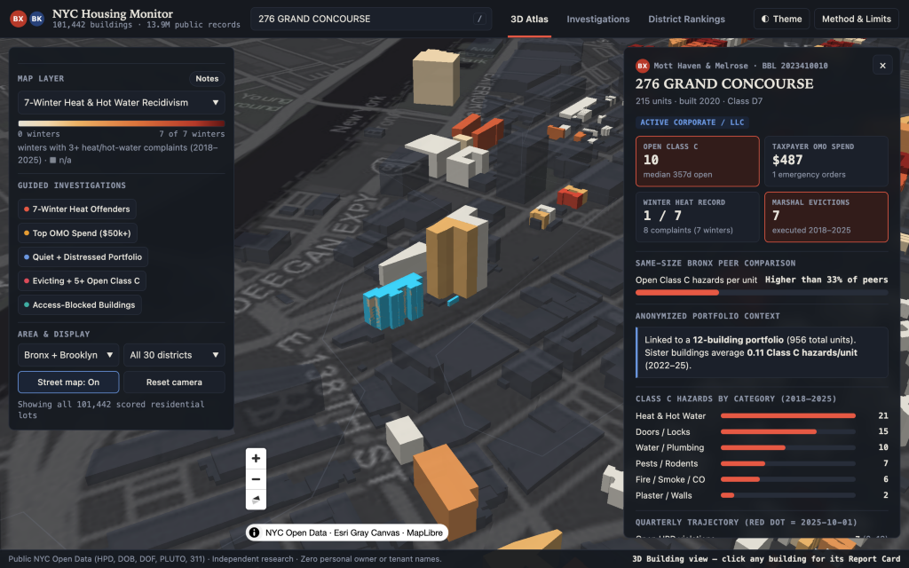
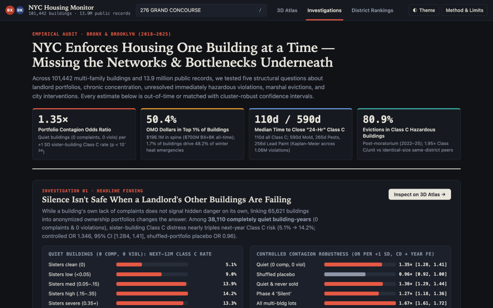
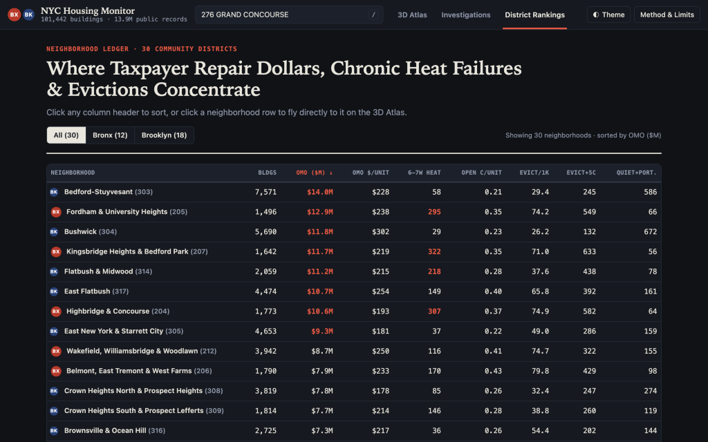

# The 3D Atlas & Investigations App (`app/web/`)

A static, zero-build-step civic cartography web application (MapLibre GL JS 4.7.1 + PMTiles 3.2.0) rendering **120,705 scored 3D building footprints** (across 101,442 Bronx and Brooklyn multi-family lots) at their real roof heights, paired with an interactive **Investigations** broadsheet and a sortable **District Rankings** ledger.



### Investigations Broadsheet


### Sortable 30-District Neighborhood Rankings


## Run it

```bash
make serve    # serves http://127.0.0.1:8777 (loopback only, Range-request enabled)
```

Without local `app/web/data/buildings.pmtiles`, the site automatically falls back to the committed one-district sample (`app/web/data/sample/`, 1,191 footprints) while still displaying all 30 named community districts, the full Investigations broadsheet, and the District Rankings table. To rebuild the full two-borough tileset and 101k-building address search index locally:

```bash
make ingest NAMES=building_footprints   # 434,383 BX+BK footprints
make studies                            # Studies 1–5 + building distress & portfolio profiles
make map                                # builds buildings.pmtiles, 1,205 fact shards, 283 search shards (~2 min; needs tippecanoe)
```

## Three Views & Eight Map Layers

1. **3D Atlas** — Extruded 3D buildings over an Esri Gray Canvas basemap (light/dark, toggleable, offline-safe fallback) with global street-address / neighborhood / BBL search (`/` shortcut), 5 one-click **Guided Investigation** filter chips, and 8 layers:
   - *Investigations (2018–2025):* **7-Winter Heat & Hot Water Recidivism**, **Taxpayer Emergency Repair Spend (OMO \$)**, **Open "Zombie" Class C Hazards**, **Landlord Portfolio Contagion (Sister Rate)**, **Marshal Evictions Rate**.
   - *Quarterly Out-of-Time Models (16 snapshots, 2022–2025):* **Enforcement Risk Forecast**, **Complaint Gap Diagnostic (Phase 4)**, **Inspector No-Access Rate** (with bottom-center timeline scrubber and `←`/`→` keyboard stepping).
2. **Building Report Card** — Click any building (or search any street address) for street address, neighborhood, HPD registration badge, 4-card severity strip (Open Class C + median open age, OMO \$, 7-winter heat record, evictions), same-size borough peer percentile bar, anonymized portfolio contagion context, Class C hazard category breakdown, and 16-quarter sparklines.
3. **Investigations & District Rankings** — Interactive visual broadsheet of all 5 empirical studies (`app/web/data/studies_digest.json`) with one-click *"Inspect on 3D Atlas"* jump buttons, plus a sortable 30-neighborhood ledger (`app/web/data/districts.json`).

## Privacy & Architecture

- **Zero personal names:** No owner, landlord, managing agent, respondent, or tenant names exist anywhere in tiles, shards, or JSON files. Portfolio context uses anonymized links derived from HPD registration business addresses.
- **Static & sharded:** Score time series are packed as 48-character strings (16 × 3-digit codes) so stepping snapshots requires zero reloads. Building Report Cards (`facts/<5-digit-prefix>.json`, 1,205 shards) and street-address lookup (`search/<2-char-prefix>.json`, 283 shards) stay gitignored locally while the compact sample and aggregate files commit cleanly.
- **Vendored libraries:** MapLibre GL JS 4.7.1 and PMTiles 3.2.0 in `app/web/vendor/` (see [LICENSE_NOTE.md](LICENSE_NOTE.md) and `THIRD_PARTY_NOTICES.md`).
