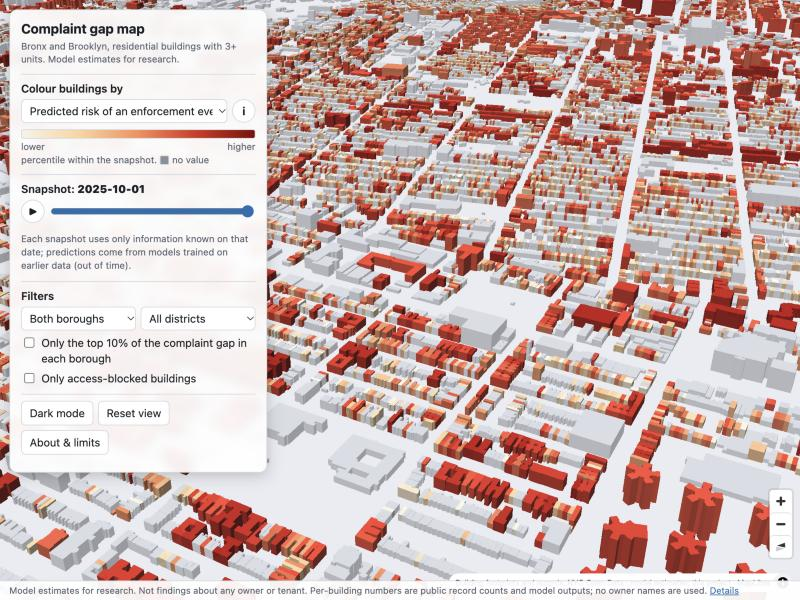
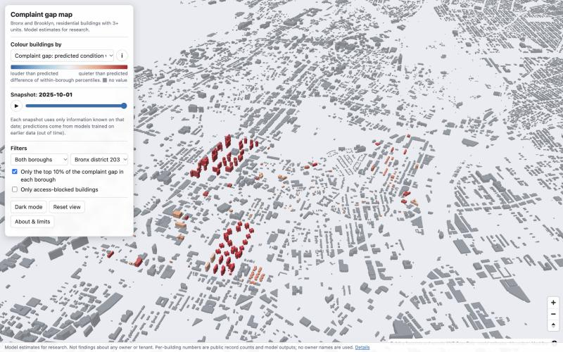

# Phase 6: the 3D map

A static website (no server code, no external services at view time) showing Bronx and Brooklyn residential buildings as extruded 3D footprints at their real roof height,
coloured by one of five model-derived layers, with a snapshot slider, filters, a click panel, shareable links and a disclaimer. It runs locally from the repository; no hosted service is involved.



| | |
|---|---|
|  |  |
| Click panel: model estimates, public record counts, time series | Complaint gap layer |
|  |  |
| Zoomed-out default: district averages, dark mode | District focus with the "top 10% of the gap" filter |

Slider animation: [img/map_slider.gif](img/map_slider.gif) (Bronx, risk layer, four snapshots).

## Run it

```bash
make ingest NAMES=building_footprints   # 434,383 footprints for BX+BK, resumable (about 3 minutes with a Socrata token)
make features && make silent            # scores (Phases 2 to 4), if not built yet
make map                                # joins footprints to scores, builds tiles and fact shards (about 2 minutes; needs tippecanoe)
make serve                              # http://127.0.0.1:8777  (loopback only)
```
Open the page, read the disclaimer, then use the layer menu (the "i" button explains each layer), the slider and the filters. Without `data/buildings.pmtiles` the page falls back to the committed sample
(one community district, `?sample=1` forces it); no tile server is needed for that. In sample mode the page says so, outlines the sample district, and still shows district averages for both boroughs when zoomed out.

The layer, snapshot and camera are written to the URL (`#l=gap&s=15&v=lng,lat,zoom,pitch,bearing`), so a view can be bookmarked or shared. The clicked building is highlighted until its panel is closed.

## What is on the map

| Layer (neutral names on purpose) | What it is | Source |
|---|---|---|
| Predicted risk of an enforcement event | LightGBM probability of a vacate order, OMO charge, AEP selection or HPD litigation in the next 12 months, as a percentile within the snapshot | Phase 3, `scores_phase3.parquet` |
| Predicted condition (no complaint information) | Phase 4 condition model, primary outcome (vacate order or DOB physical-hazard violation); static fields and earlier city actions only | Phase 4, `p_hat` |
| Complaint gap: predicted condition vs complaints | within-borough percentile of predicted condition minus within-borough percentile of (shrunk) complaints per unit. Warm = quieter than predicted, cool = louder | Phase 4, `gap_rank` |
| Share of closed complaints with no inspector access | no-access share of problems closed in the last 12 months; grey where nothing closed | Phase 2 features |
| Observed complaints per unit (12 months) | HPD complaint problems per residential unit | Phase 2 features |

Height is the real roof height from the building footprints dataset (feet converted to metres). Buildings outside the analysis (non-residential, under 3 units, no PLUTO match) are grey context. Colours at the lot level are inherited by every footprint on the lot.
The default zoomed-out view shows **district averages** (approximate shapes derived from the footprints; coloured on a scale of the district averages themselves, zero-centred for the complaint gap, with its own legend), and building detail appears from zoom 12 to 13.4, so the default is aggregate rather than building by building.

### How to read the complaint gap (and what it does not mean)

The Phase 4 validation found that buildings in the top decile of the gap are **not** at hidden extra risk: they had about 16% fewer later vacate or DOB-hazard events than the model predicted (observed/predicted 0.84, 95% CI 0.76 to 0.91)
and 35% fewer than comparable louder buildings. Most buildings (77%) have no HPD complaint in a year, so silence is ordinary. The access-blocked mechanism is real (about 16% of closed complaint problems end with "unable to gain access") but access-blocked buildings
showed no hidden extra risk either. The layer is a research diagnostic. The disclaimer appears on first load and in the footer, and the layer menu has a help text.
See [silent_distress_phase4.md](silent_distress_phase4.md).

## Privacy and scope

- No owner names, tenant information or contacts anywhere in the tiles, shards or page. The only per-building numbers are model outputs and public record counts (violations, complaint problems, 311 requests, evictions, DOB violations, earlier OMO/litigation/vacate/AEP counts).
- Per-building data is in gitignored files (`app/web/data/facts/`, `app/web/data/buildings.pmtiles`). What can be committed: the code, `app/web/data/sample/` (one community district), `districts.json` (30 aggregate rows) and `meta.json`. A test checks the sample's property list.
- Model estimates are wrong for many individual buildings; the page says so.

## Design notes

- **Data packing.** Each score series is a string of 16 three-digit numbers (one per snapshot, 999 = no value), so moving the slider only slices a string inside a MapLibre expression and no data is reloaded. Colour layers are percentiles within the snapshot (risk, condition),
  a rescaled difference (gap), a share (access) or a capped rate (complaints). 80 numbers per building would have been too heavy as separate tile properties.
- **Tiles.** `tippecanoe` builds one PMTiles file (93 MB) with a `scored` layer (120,705 footprints on the 101,442 scored lots, zoom 12 to 16) and a `context` layer (313,630 other footprints, zoom 14 to 16). PMTiles needs HTTP Range requests, which `python -m http.server` lacks, so `app/web/serve.py` adds them.
- **Click panel.** Fetches a per-block JSON shard (`facts/<first 5 digits of the BBL>.json`, 1,205 shards, 119 MB in total, about 100 KB each) and draws sparklines. No server is involved.
- **Libraries** (vendored in `app/web/vendor`, fetched once from the npm registry, pinned, BSD-3-Clause; MapLibre's license text is alongside, PMTiles' npm package ships no license file, see `docs/LICENSE_NOTE.md`): MapLibre GL JS 4.7.1 and PMTiles 3.2.0. There is no basemap (no external tiles, works offline), so the map shows buildings and district averages only.
- **Verification.** Served locally and driven in a browser: tiles load over Range requests, the layers, slider, filters, click panel, dark mode and the sample fallback all work, with no console errors. Screenshots above were taken from that run.

## Known limits

- Footprints carry the scores of their lot, so a lot with several buildings shows the same colour on each.
- 471 of the 101,442 scored lots have no footprint on their base or MapPLUTO BBL (condo billing lots, merged lots) and do not appear on the map.
- District shapes are approximate (unions of building footprints, buffered and simplified) and are only for aggregation.
- Only the 16 out-of-time snapshots (2022-01-01 to 2025-10-01) exist; earlier snapshots were training data and have no honest out-of-sample score.
