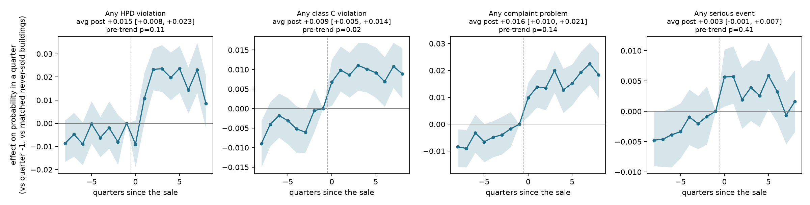
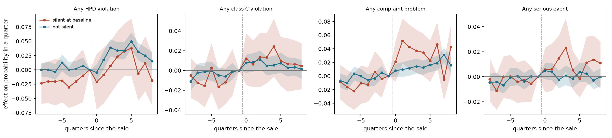

# Phase 5: what happens to a building's record after a sale?

Status: done 2026-11-14. Everything here is aggregate; no owner or buyer name was read, stored in an output or used.

## 1. The question and the answer in short

**Question.** When a rental building in the Bronx or Brooklyn is sold, does its record of violations, complaints and serious events change, and does it change differently for buildings that were *silent* before the sale (many problems predicted, few complaints heard)?

**Answer (modest, mixed, and not a clean causal claim).**

- After a whole-building arms-length sale, the share of building-quarters with at least one HPD violation rises by about **1.5 percentage points** (baseline 21% per quarter, so about +7%), and the share with a complaint problem rises by about **1.6 points** (baseline 10%, about +16%). Both survive the control-group choice. After removing a linear pre-sale drift (section 5) they are about +1.4 points [0.6, 2.3] and +1.1 points [0.3, 1.8].
- Class C (immediately hazardous) violations rise by 0.9 points [0.5, 1.4] but the **pre-trend test flags this one** (p = 0.019) and after trend removal the interval touches zero ([-0.03, +1.3] points).
- **Serious events (emergency repair charges, litigation, vacate orders, AEP) show no detectable change**: +0.3 points [-0.1, +0.7], and about 0 after trend removal.
- **Silent buildings do not respond detectably differently** from the rest. The silent group is small (453 sold buildings), so intervals are wide: silent minus not-silent for any violation is -2.0 points [-5.7, +1.6]; for any serious event +0.9 points [-0.5, +2.2].

This is a **null-to-weak result on the interesting question** (silent buildings, serious events) and a **small, plausible, but not cleanly causal increase in recorded activity** overall. Section 6 lists what it does not show.

## 2. Data, and the ACRIS pivot (a data-quality finding)

The plan was to use ACRIS (the city's property-record system) because it carries deeds. A feasibility spike (`pipelines/sales_feasibility.py`, rule declared before running: usable only if the source's recent volume is at least 60% of an independent count **and** at least 800 arms-length matched sales have a full 8+8 quarter window) found that **the ACRIS Master open-data extract is badly incomplete**:

| Year | ACRIS deed documents (open-data Master extract, BX+BK) | DOF priced sales | ACRIS as % of DOF |
|---|---|---|---|
| 2018 | 4,427 | 20,161 | 22.0% |
| 2019 | 3,613 | 19,672 | 18.4% |
| 2020 | 1,823 | 15,976 | 11.4% |
| 2021 | 1,899 | 24,606 | 7.7% |
| 2022 | 1,711 | 22,972 | 7.4% |
| 2023 | 1,581 | 16,758 | 9.4% |
| 2024 | 1,526 | 17,160 | 8.9% |
| 2025 | 1,372 | 18,230 | 7.5% |

2021-2025 ratio: 0.081, so ACRIS **fails** the coverage rule. ACRIS's `document_date` also contains impossible years, so recording date would have been needed. The ACRIS parties table (pulled only for the deeds we had) contains names; **the pivot means no party data is used.** (The raw ACRIS pulls, including party names, were deleted on 2026-11-14. The coverage table in `reports/phase5/acris_vs_dof_coverage.csv` is the kept evidence; re-running that part needs `pipelines/ingest/pull_acris.py`. The study itself does not use ACRIS.)

The pivot is the Department of Finance annualized sales files (`w2pb-icbu`), complete for 2016-2025 and free of party names. Rolling-calendar sales (`usep-8jbt`) show about 18,000 priced Bronx+Brooklyn sales in the latest 12 months, consistent with DOF volume.

Sale definition (`src/nycdistress/sales.py`): a DOF row on an analysis building, no apartment number, building class category in three-family, rental walk-up, rental elevator or 4-10 unit rental, price at least $100,000 **and** at least $25,000 per residential unit (a proxy for arms-length: intra-family and nominal transfers are cheap). Condo units, parking and co-op apartments are apartment-level transactions that DOF records against the building lot; they are **not** building sales. (Counting them first inflated the match to 117,233 sales; this was caught in the spike and fixed before any outcome was looked at.)

Attrition:

| Step | Buildings / rows |
|---|---|
| DOF sale rows in the data | 301,701 |
| whole-building rows on analysis buildings (any price, any year) | 42,416 |
| arms-length proxy sales 2018 onward | 17,553 |
| distinct buildings with such a sale | 15,766 |
| first sale with a full window (8 before, 8 after) and no other sale inside it | 8,500 |
| analysis buildings with no whole-building DOF row at all (never-treated controls) | 70,157 |
| in the marts (analysis universe) - treated | 8,500 |
| in the marts (analysis universe) - never-treated controls | 70,157 |

The spike counted 8,480 lots in the full-window cohort; the study table counts 8,500 because the spike joined sales to the building table through a slightly different key. Both far exceed the 800 threshold. The study's number is the one used everywhere below. Cohort sizes by quarter run from 189 to 653 buildings; none is under 25 (`reports/phase5/study_cohorts.csv`).

Treated and control buildings differ (`reports/phase5/study_balance.csv`): sold buildings are smaller (8.0 vs 15.6 residential units on average), more often built before 1930 (54% vs 49%) and have more violations per unit in 2018-19 (0.94 vs 0.64). This is why the primary estimate reweights controls to the treated mix.

## 3. Method

- **Outcomes**, per building per calendar quarter (quarter 0 = 2018Q1; last quarter 34 = 2026Q3, the 2026Q4 quarter is incomplete and left out): any HPD violation; any class C violation; any complaint problem; any serious event; violation count and complaint count (both winsorized at the pooled 99.5th percentile).
- **Treated**: first qualifying sale between 2020Q1 and 2024Q3 with 8 quarters of record before and 8 after and no other qualifying sale inside that window. Treatment time `G` is the quarter of the sale.
- **Controls**: analysis buildings with no whole-building DOF sale row at all (priced or not), 70,157 buildings.
- **Estimator**: staggered-adoption event study in the Callaway and Sant'Anna (2021) style, implemented in `src/nycdistress/did.py` (no package was used). For each cohort and event time, `ATT(G, G+e)` is the change from the quarter before the sale (`G-1`) among treated buildings minus the same change among comparison buildings; event-time effects are cohort-size-weighted averages. This avoids the forbidden comparisons (already-treated units as controls) that bias ordinary two-way fixed effects under staggered timing and heterogeneous effects. Tests (`tests/test_did.py`) show it recovers a known effect with heterogeneous cohorts, returns zero on a null, detects an injected pre-trend, and that the stratified weights remove a composition bias that the unweighted version has.
- **Primary specification** (declared in the script header before the results): never-treated controls reweighted, inside every bootstrap draw, to the treated mix of borough x unit-size band (3-5, 6-10, 11-20, 21+) x construction era (pre-1930, 1930-60, later) x terciles of 2018-19 violations per unit (a period before every sale in the sample). 73 strata (every one with treated buildings also has controls); treated buildings in a stratum with no controls are dropped from that draw.
- **Robustness**: (a) never-treated controls without reweighting; (b) not-yet-treated controls (staggered, unweighted).
- **Intervals**: 400 cluster-bootstrap draws resampling buildings. Joint **pre-trend test**: Wald statistic on the seven pre-period coefficients (event times -8 to -2) using the bootstrap covariance. **Pre-trend adjustment** (a simpler, documented alternative to HonestDiD): fit a line through the pre-period coefficients (and the zero at -1), extrapolate it into the post period, subtract it; its interval comes from the same draws.
- **Silent vs not silent**: the Phase 4 silent flag (top decile of the within-borough complaint-gap rank) at the 2022-01-01 snapshot, which is the first out-of-time score date; so this split uses only sales from 2022Q2 on (4,480 treated), and controls are split by the same flag so each group is compared with similar controls. Groups are disjoint, so the difference uses independent bootstrap draws.

## 4. Results

Main table (primary specification; effects are changes in the share of building-quarters with the event, or in counts; "Relative" is divided by the treated pre-sale mean):

| Group | Outcome | Treated / controls | Pre-sale mean | Avg post-sale effect [95% CI] | Relative | After removing the pre-trend [95% CI] | Pre-trend p |
|---|---|---|---|---|---|---|---|
| all sales | any_violation | 8,500 / 70,157 | 0.214 | +0.0153 [+0.0082, +0.0231] | +7% | +0.0142 [+0.0057, +0.0228] | 0.111 |
| all sales | any_class_c | 8,500 / 70,157 | 0.059 | +0.0091 [+0.0049, +0.0141] | +15% | +0.0062 [-0.0003, +0.0133] | 0.019 |
| all sales | any_complaint | 8,500 / 70,157 | 0.101 | +0.0161 [+0.0102, +0.0212] | +16% | +0.0113 [+0.0032, +0.0182] | 0.143 |
| all sales | any_serious | 8,500 / 70,157 | 0.033 | +0.0033 [-0.0008, +0.0071] | +10% | -0.0002 [-0.0049, +0.0049] | 0.414 |
| all sales | violations_n | 8,500 / 70,157 | 1.122 | +0.1144 [+0.0143, +0.2095] | +10% | +0.0682 [-0.0941, +0.2085] | 0.170 |
| all sales | complaints_n | 8,500 / 70,157 | 0.808 | +0.2434 [+0.1463, +0.3287] | +30% | +0.2071 [+0.0671, +0.3247] | 0.134 |
| sales 2022Q2+ | any_violation | 4,480 / 68,887 | 0.265 | +0.0246 [+0.0135, +0.0361] | +9% | +0.0189 [+0.0053, +0.0312] | 0.486 |
| sales 2022Q2+ | any_class_c | 4,480 / 68,887 | 0.061 | +0.0063 [-0.0004, +0.0124] | +10% | +0.0034 [-0.0051, +0.0124] | 0.085 |
| sales 2022Q2+ | any_complaint | 4,480 / 68,887 | 0.102 | +0.0170 [+0.0099, +0.0238] | +17% | +0.0091 [-0.0015, +0.0197] | 0.085 |
| sales 2022Q2+ | any_serious | 4,480 / 68,887 | 0.033 | +0.0019 [-0.0041, +0.0064] | +6% | -0.0019 [-0.0097, +0.0054] | 0.241 |
| sales 2022Q2+ | violations_n | 4,480 / 68,887 | 1.171 | +0.0998 [-0.0502, +0.2368] | +9% | -0.0671 [-0.2734, +0.1176] | 0.005 |
| silent at baseline | any_violation | 453 / 7,016 | 0.263 | +0.0063 [-0.0279, +0.0408] | +2% | +0.0036 [-0.0289, +0.0400] | 0.813 |
| silent at baseline | any_class_c | 453 / 7,016 | 0.025 | +0.0108 [-0.0105, +0.0290] | +43% | +0.0098 [-0.0115, +0.0300] | 0.265 |
| silent at baseline | any_complaint | 453 / 7,016 | 0.045 | +0.0326 [+0.0097, +0.0530] | +72% | +0.0207 [-0.0112, +0.0480] | 0.471 |
| silent at baseline | any_serious | 453 / 7,016 | 0.013 | +0.0099 [-0.0030, +0.0221] | +78% | +0.0100 [-0.0041, +0.0261] | 0.538 |
| silent at baseline | violations_n | 453 / 7,016 | 0.530 | +0.1089 [-0.1999, +0.3901] | +21% | +0.1023 [-0.2000, +0.3930] | 0.137 |
| not silent | any_violation | 4,027 / 61,871 | 0.265 | +0.0267 [+0.0164, +0.0377] | +10% | +0.0206 [+0.0087, +0.0333] | 0.429 |
| not silent | any_class_c | 4,027 / 61,871 | 0.065 | +0.0058 [-0.0010, +0.0126] | +9% | +0.0027 [-0.0073, +0.0126] | 0.117 |
| not silent | any_complaint | 4,027 / 61,871 | 0.109 | +0.0154 [+0.0069, +0.0237] | +14% | +0.0078 [-0.0041, +0.0205] | 0.054 |
| not silent | any_serious | 4,027 / 61,871 | 0.035 | +0.0010 [-0.0042, +0.0066] | +3% | -0.0032 [-0.0107, +0.0055] | 0.150 |
| not silent | violations_n | 4,027 / 61,871 | 1.243 | +0.0980 [-0.0735, +0.2485] | +8% | -0.0859 [-0.3069, +0.1390] | 0.008 |

Figures: `reports/phase5/figures/event_study_all.png`, `reports/phase5/figures/event_study_silent_vs_not.png`.





Robustness (all sales):

| Control group | Outcome | Avg post-sale effect [95% CI] | Pre-trend p |
|---|---|---|---|
| never-sold, no reweighting | any_violation | +0.0149 [+0.0078, +0.0221] | 0.005 |
| never-sold, no reweighting | any_class_c | +0.0069 [+0.0027, +0.0124] | 0.168 |
| never-sold, no reweighting | any_complaint | +0.0138 [+0.0084, +0.0193] | 0.628 |
| never-sold, no reweighting | any_serious | +0.0025 [-0.0014, +0.0062] | 0.683 |
| never-sold, no reweighting | violations_n | +0.0739 [-0.0309, +0.1808] | 0.454 |
| never-sold, no reweighting | complaints_n | +0.1994 [+0.1027, +0.3017] | 0.230 |
| not-yet-sold (staggered) | any_violation | +0.0147 [+0.0068, +0.0214] | 0.009 |
| not-yet-sold (staggered) | any_class_c | +0.0069 [+0.0022, +0.0113] | 0.095 |
| not-yet-sold (staggered) | any_complaint | +0.0137 [+0.0080, +0.0195] | 0.661 |
| not-yet-sold (staggered) | any_serious | +0.0024 [-0.0018, +0.0063] | 0.675 |
| not-yet-sold (staggered) | violations_n | +0.0726 [-0.0307, +0.1760] | 0.360 |
| not-yet-sold (staggered) | complaints_n | +0.1993 [+0.1033, +0.2915] | 0.142 |

Reading the table:

- The headline increases (any violation, any complaint) are the same size under all three control choices.
- Violation probability dips slightly in the sale quarter itself (-0.9 points) and then steps up for the following seven quarters (about +2 points). This looks like a change at the transition rather than a slow drift.
- Complaint probability and class C violations were **rising before the sale** (see section 5), so part of their post-sale increase continues an existing drift.
- The "serious event" estimates have wide intervals; the post-sale average is about one third of a point on a 3.3% base. A real effect of up to about +0.7 points (+20%) is not ruled out, and neither is zero.
- The silent group is too small to say much (453 treated buildings): its complaint effect (+3.3 points [+1.0, +5.3]) is larger than the rest's, but the difference is not significant once the trend is removed (+2.1 [-1.1, +4.8]) and the any-violation and serious-event differences have intervals that include zero.

## 5. Pre-trends and honest limits

- Primary spec joint pre-trend tests: any violation p = 0.11, class C p = 0.019, any complaint p = 0.14, serious p = 0.41. With six outcomes one p-value below 0.05 is roughly what chance alone produces, but the class C and complaint panels *visibly* drift upward before the sale. The trend-adjusted column is the conservative reading and is the one to quote for those two.
- Non-reweighted never-sold controls show a pre-trend for any violation (p = 0.005), which is the reason the reweighted version is primary.
- The 2020Q2 pandemic dip falls inside the event windows of buildings sold from about 2020 to 2022. Controls observe the same calendar quarters, so it differences out when the shock is common, but not if the pandemic hit sold and unsold buildings differently.

## 6. What this does not show

1. **It is not evidence that a sale harms tenants.** More recorded violations and complaints after a sale can mean new owners who register and manage actively, tenant turnover or renovation disputes, new managing agents, or simply more inspection attention on a building that changed hands. The data cannot separate these.
2. **Sale timing is not random.** Buyers and sellers choose buildings. Rising pre-sale drift in complaints suggests selection on emerging trouble. The adjustment is a sensitivity check, not a fix.
3. **Only deed-type sales appear.** Transfers of LLC membership interests (common for larger buildings) are invisible, so some "never sold" controls changed control and some treated buildings were really sold earlier.
4. **No buyer information.** By design no names are used, so we cannot split by investor type or entity size, which is the interesting question; that would require a complete ACRIS extract and care about naming individuals.
5. **Window and coverage.** Eight quarters each way; the AEP table ends in early 2026, which affects the final quarters for both groups equally but still slightly understates serious events.
6. **Silent buildings are few and the silent flag comes from a model** (Phase 4) with its own error; see `docs/silent_distress_phase4.md`.

## 7. Choices made after seeing data (disclosure)

- The whole-building restriction (no apartment number, four building categories) was added after the *first feasibility count* showed condo, parking and co-op rows inflating the match; no outcomes had been looked at.
- The primary specification, the pre-trend adjustment and the two robustness controls were written into `pipelines/sales_study.py` before the first run. A crash in the silent-group code (a nullable-boolean bug) was fixed and the script re-run from scratch; the results of the main specs were identical.
- Restricting the silent split to sales from 2022Q2 on is forced by the Phase 4 scores being out-of-time only from 2022; it is not an outcome-driven choice.

## 8. Reproduce

```bash
make sales-feasibility   # about 1 min: ACRIS-vs-DOF coverage, attrition, cohort sizes (reports/phase5/)
make sales               # about 1 min: the event study, then figures and tables
make test
```
